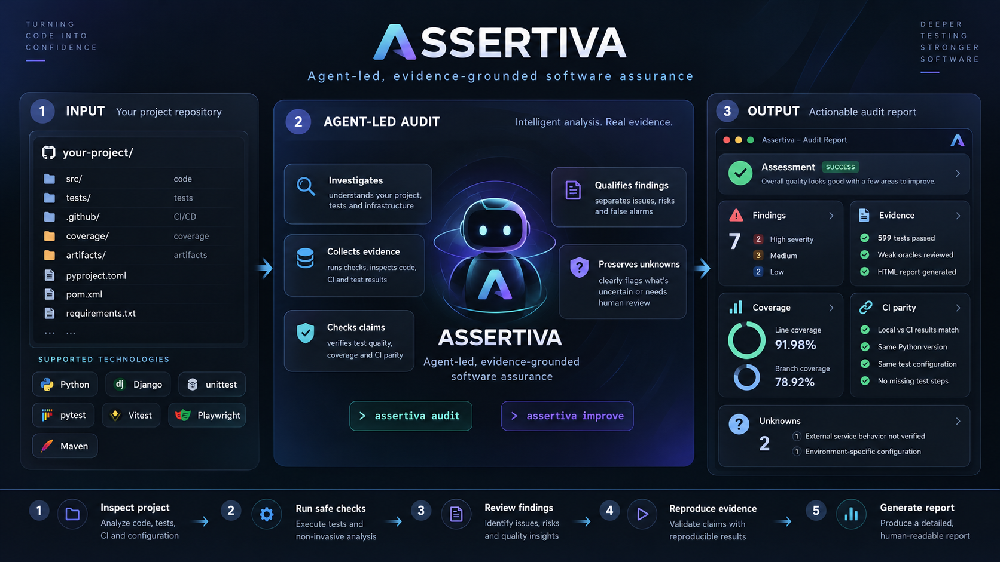

# Assertiva

[](LICENSE)



*Overview (illustrative): the auditing agent investigates the project, the engine collects and qualifies evidence, and the result is one report that keeps unknowns visible.*

**Adaptive Test Intelligence & Assurance for coding agents and engineering teams.**

Assertiva audits whether a test suite provides meaningful evidence, selects the smallest reasonable test surface for the current change or failure, localizes failures without blindly rerunning expensive suites, and expands confidence when risk or lifecycle gates require it.

> A green test suite is not automatically a strong test suite.


*The Assurance Report from a real `assertiva audit --execute` run on [`tests/fixtures/django-site`](tests/fixtures/django-site): one self-contained, offline HTML page (English / Brazilian Portuguese, light / dark).*

> **Assertiva v0.9.0** — Advanced Test Intelligence & Continuous Assurance. It is distributed as its [GitHub Release](https://github.com/Soturine/Assertiva/releases/tag/v0.9.0) (wheel and sdist, with SHA-256 checksums) and from this repository's source. It is **not** published on PyPI or in any Skill marketplace. Python 3.11 or newer.

## Quick start

```bash
# 1. Install. From a clone of this repository, or from the wheel attached to the GitHub Release:
python -m pip install -e .
python -m pip install assertiva-0.9.0-py3-none-any.whl      # alternative: the release wheel
assertiva --version                                          # assertiva 0.9.0

# 2. First audit: static. It reads the project, runs nothing and changes nothing.
assertiva audit path/to/project

# 3. Run the tests too. They run in a disposable copy, with the project's own runner.
#    --python names the project's interpreter (default: the one running Assertiva).
assertiva audit path/to/project --execute

# The last line names the report. audit.html is the page to open in a browser; audit.json holds the same evidence.

# 4. Would the tests catch a real defect? Mutation testing, run by the engine on a disposable copy
#    (the tool, e.g. Cosmic Ray, StrykerJS or PIT, must already be installed in the project):
assertiva audit path/to/project --execute --mutate src/pricing.py

# 5. Improve. The first call measures the baseline and prints a candidate workspace; write test changes there.
assertiva improve path/to/project
assertiva improve path/to/project                            # qualifies them; the project is still untouched
assertiva improve path/to/project --approve <change-id>      # your decision: only approved changes are applied
assertiva improve path/to/project --discard                  # or drop the candidate
```

A reproducible end-to-end example, with the numbers observed, is in [Proof of Protection](docs/PROOF_OF_PROTECTION.md). For how the agent uses all of this, see [SKILL.md](SKILL.md).

## Why

Modern coding agents can generate, modify, run, and even "fix" tests very quickly. That creates a new failure mode: implementation, tests, and validation can all share the same wrong assumption while CI remains green.

Assertiva separates three questions:

```text
FAST FEEDBACK
!= REGRESSION CONFIDENCE
!= TEST QUALITY
```

It asks four related questions:

1. **Are these tests actually good?**
2. **Which tests and diagnostics do we need right now?**
3. **Does CI/CD actually execute the evidence the repository appears to have?**
4. **What does a green result really prove — and what remains unverified?**

Assertiva is not limited to Test Cases produced by Functional Test Designer and is not architecturally tied to Python, pytest, Django, Playwright, GitHub Actions, or any specific stack. Existing tests, validators, linters, type checkers, build/package steps, schema/migration checks, security checks, hooks, CI/CD gates and deployment verification are all first-class verification evidence through capability-driven adapters. FTD is an optional source of authority-rich Test Cases, not a prerequisite.

Framework/tool-specific support grows adapter by adapter; the core stays language-, framework-, runner- and CI-provider-neutral. Unknown tooling must be preserved as UNKNOWN/CUSTOM evidence rather than guessed or silently ignored.

## Core capabilities

### AUDIT — test quality
Inspect assertion strength, oracle authority, missing negative/boundary cases, mock fidelity, flaky behavior, redundant tests, E2E-only critical coverage, mutation/negative-control evidence, integration fidelity, and false-green patterns.

### SELECT / RUN — adaptive execution
Use change impact, dependency/runtime evidence, history, critical journeys, and project policy to run high-signal tests first without pretending a selected subset is equivalent to a full release gate.

### DIAGNOSE — failure localization
When an E2E or large suite fails, find the first divergent stage, descend to the smallest useful reproducer, cluster repeated failures, and progressively escalate diagnostics instead of dumping every trace into an agent context.

### VERIFY — confidence expansion
After a fix, rerun the reproducer, affected regression, relevant integration/E2E evidence, and broader/full gates when required by risk or release policy.

### SEMANTIC UI ASSURANCE — test the user contract
For browser/component UI tests, distinguish semantic role/name/state, keyboard/focus behavior, interaction, visual output, storage/network state and backend effects. Detect locators coupled to incidental DOM structure, preserve legitimate test-ID/structural contracts, and challenge UI tests with non-behavioral structural mutations when useful.

Accessibility-tree and ARIA evidence are first-class observation surfaces, but zero automated accessibility findings do not prove complete accessibility. Snapshot updates require intent/provenance, and retries/timeouts do not erase the first failure.

### VERIFICATION SURFACE — understand every gate
Inventory the checks that can influence confidence or block delivery: tests, lint, type checks, format/static analysis, generated-code/schema checks, migrations, localization/i18n validation, security scans, build/package/container/startup/health/deploy checks, hooks and custom project commands. Preserve where each check runs, whether it is blocking/advisory/unknown, and what evidence it actually produces.

### PIPELINE & DELIVERY ASSURANCE — challenge false green
Compare the repository verification surface with the commands and environments actually observed locally, in hooks, CI/CD and deployment. Surface omitted checks, narrowed scopes, matrix gaps, source-tree-vs-built-artifact gaps and other cases where one green stage does not represent the delivery path.

### REFACTOR SAFETY — preserve behavior
Evaluate whether a module or whole project has a strong enough behavioral safety net before structural change. Map important behaviors/contracts to tests and classify the refactor target as READY, READY_WITH_GAPS, NOT_READY, or UNKNOWN.

## Design principles

- **Evidence over green status.**
- **Behavior over coverage percentage.**
- **The agent investigates; the engine measures and verifies.** Provenance (observed, declared, inferred, unknown) is always labeled and never decides importance.
- **Language/framework-neutral semantics; adapters translate capabilities instead of redefining policy.**
- **Smallest sufficient evidence first; broader confidence when required.**
- **Never weaken a test merely to make it pass.**
- **Retries classify flakiness; they do not erase the first failure.**
- **Selector uncertainty widens execution.**
- **Raw evidence is retained; agent context is compressed.**
- **Framework capability detection beats hardcoded `-vvv`.**
- **Parameterized/data-driven invocations, structured errors, branch-aware coverage, property/fuzz evidence and dynamic tests are first-class evidence.**
- **No hard dependency on Derivanta or any one runner/tool.**

## Cross-language / cross-framework model

The core works with normalized concepts rather than Python/Java/JS-specific syntax:

```text
suite
→ test definition
→ invocation / parameter case
→ attempt / retry
→ assertion / oracle
→ result
→ coverage / error / trace evidence
→ revision + environment
```

The model is designed to accommodate ecosystems such as pytest, JUnit, Jest, Vitest, Playwright, xUnit/NUnit, Go, Rust, PHP and Ruby runners, custom runners and future frameworks.

**Implemented today:** native adapters for pytest, unittest and Django `manage.py test` (Python), Jest and Vitest (JavaScript/TypeScript), Playwright, Maven (Surefire/Failsafe, JUnit Platform) and Gradle (Java, Kotlin/JVM, Android local tests, Kotlin Multiplatform JVM targets) — the project's declared runner decides which one runs ([capabilities](adapters/README.md)); portable evidence from JUnit XML, CTRF and Allure results, coverage (coverage.py, istanbul, LCOV, Cobertura, JaCoCo), mutation reports, Pact contracts and verifications and axe-core accessibility results, with the engine's own runs exported as CTRF on request (`--ctrf`); mutation testing executed by the engine with the tool that fits the project (Cosmic Ray under the declared Python runner, StrykerJS for Jest/Vitest, PIT for Maven), and `improve` proving the protection a strengthened test adds ([walk-through](docs/PROOF_OF_PROTECTION.md)); CI configuration from GitHub Actions, Azure Pipelines, GitLab CI and Jenkins; change-based selection with cosmetic, dependency and declared changes and a history-based order; failure history with inferred origin, novelty and order-dependence probes.

With the owner's consent, `--execute --provision` prepares what the tests need outside the project (a virtual environment, `npm ci`, a JDK and Gradle, a disposable PostgreSQL) and removes it afterwards. Every audit also reports test effectiveness — likely false greens, weak oracles, fidelity mismatches, redundancy and smells — from one model shared by Python, JavaScript/TypeScript and Kotlin/Java, as leads the agent confirms or rejects.

**Not implemented yet:** .NET (xUnit/NUnit/MSTest), Go, Rust, PHP and other ecosystems; Android instrumented tests and non-JVM Kotlin Multiplatform targets are listed, not run. They degrade conservatively and explicitly to CUSTOM/UNKNOWN evidence, never to "0 tests" and never by silently inventing flags. Engine-run mutation testing covers Python, JavaScript/TypeScript (Jest, Vitest) and Maven; PIT through Gradle is import-only, and other ecosystems are planned for 1.0. Assertiva is not distributed through PyPI or any marketplace. See [STATUS.md](STATUS.md) and [ROADMAP.md](ROADMAP.md).

## Test Evidence Graph

```text
Requirement
  -> Behavior
     -> Component
        -> Code
           -> Test
              -> Assertion
                 -> Evidence
                    -> Run
```

Useful relations include `depends_on`, `validates`, `covers`, `kills_mutant`, `reproduces`, `isolates`, and `composes_into`.

## User-facing workflow

Assertiva keeps the interface intentionally small:

```bash
assertiva audit
assertiva improve
```

- `audit` analyzes the project and **never changes project files**. It inventories tests/checks, measures available evidence, finds gaps and produces recommendations plus an HTML Assurance Report.
- `improve` starts from the audit, builds candidate test/verification improvements in an isolated workspace, **tests the tests**, compares baseline vs candidate, and asks for approval before any project change. Candidate qualification can include mutation/negative controls, original regression, coverage/oracle analysis, pipeline-equivalent checks, build/artifact verification. Preview deployment is a specified dimension, not an executable one: today qualification reports it as not evidenced (production is never used); provider support is future work (see [ROADMAP.md](ROADMAP.md)).

Isolation, candidate workspaces, patch application and post-apply verification are implementation details rather than extra user-facing modes. The runtime enforces write boundaries; prompt instructions alone are not considered sufficient protection.

The HTML Assurance Report is the main product surface: one self-contained, offline page per run, in English and Brazilian Portuguese. It has two layers over the same evidence.

- **Decision** — the conclusion and why, what was executed, an integrated next step, *Confirmed / Needs attention / Not proven*, a **What does green prove?** audit scope (executed, measured, inspected, declared, not proven) and, for `improve`, whether the candidate is ready and where it stands: baseline → candidate → review → approval → applied.
- **Auditability** — every metric, run and declared verification check, the evidence delta, provenance (which Assertiva produced the evidence and rendered the page) and the raw JSON, behind disclosure.

There is no aggregate score. Candidate metrics are never presented as already applied. Assertiva's own presentation and generated narrative are localized; raw technical or external evidence (commands, paths, tool output) stays in its original language. Original tests stay untouched in the project until human approval; retirement candidates are never auto-deleted or silently commented out. Details: [User Experience and Reporting](docs/USER_EXPERIENCE_AND_REPORTING.md).

### Isolation, approval and limits

- **Static by default.** `assertiva audit` reads files; it runs nothing. Tests run only with `--execute`, with the project's own declared runner, in a disposable copy of the project (installed dependency directories such as `node_modules` are linked into the copy, never copied).
- **Read-only guard.** Every project file is fingerprinted before and after an audit; if any changed, the command exits 3.
- **Not a sandbox.** Project code runs with your user's permissions and network. Run it only on projects whose tests you would run yourself. [Execution Security](docs/EXECUTION_SECURITY.md) lists what is enforced and the residual risks.
- **Consent is yours, never the repository's.** Preparing environments needs your `--provision` flag (or `provision = true` in your consent file); reproducing a discovered CI or hook step needs `--run-check`; migrations, containers and unknown commands also need the exact command authorized in `<ASSERTIVA_HOME>/consent.toml`, outside every project. Deploy and publish commands never run.
- **Improve changes nothing until you approve.** Candidate changes are written only in the candidate workspace; applying needs `--approve` with the change ids, refuses if the project or the candidate changed since qualification, and is verified afterwards.
- **A tool Assertiva needs is never installed for you.** A missing test runner or mutation tool makes that step BLOCKED with the reason; BLOCKED is never a pass.

### Mutation testing: run by the engine, or imported

| | Run by Assertiva (`--mutate FILE`) | Imported (`--mutation-report`) |
|---|---|---|
| Tools | Cosmic Ray (Python tests under pytest, unittest or Django), StrykerJS (Jest or Vitest), PIT (Maven builds that declare `pitest-maven`) | Stryker-family JSON, PIT `mutations.xml`, Cosmic Ray `dump`, mutmut stats (counts only) |
| Choice | by what the project uses; `--mutation-tool` picks one when several apply; never all of them | the report's own tool |
| Where | a disposable copy of the measured state, with a configuration Assertiva writes | wherever it was produced |
| Tied to the state | yes: the sources it mutated and the tests it ran are recorded from the copy | only if the report shows both the source and the tests it ran and they match; otherwise it is a lead |
| In `improve` | the same mutants run on the baseline and on the candidate: protection gained and lost | compared only when tied on both states |
| Limits | the suite must pass first; Cosmic Ray refuses more than 300 planned mutants; StrykerJS and PIT run every mutant of the named files; a run that did not finish never passes; PIT through Gradle is import-only | what the report records |

Negative controls (deliberate, hand-made breaks of behavior) are a separate instrument and are named as such in the report.

### Skill, engine and evaluation

| Surface | What you get |
|---|---|
| `/assertiva` with the engine installed | the auditing agent: reads code, tests and CI, decides what evidence the question needs, runs the engine when it helps, reconciles engine findings with what it finds, and attaches its assessment to the engine's report |
| `/assertiva` without the engine | the same investigation from what the agent can read and run safely in a copy; no engine evidence and no HTML report, and it says so |
| `assertiva audit` / `assertiva improve` (the CLI, no agent) | the deterministic engine on its own: evidence, report and the approval flow, without an agent's judgment |
| [`evals/semantic.py`](evals/semantic.py) | evaluation/benchmark of the Skill itself; its PASS/FAIL/REVIEW verdicts are never part of a normal audit |

The Skill is this repository's `SKILL.md` and its [references](references/); put or link that directory where your agent loads skills. How the agent works, its boundaries and its claim classes live in [SKILL.md](SKILL.md). The engine is optional for the Skill and independent of it. The Skill's guidance is checked by deterministic tests of the engine it points to, not by behavioral evaluation with agents: that evaluation is planned for 1.0 (see [ROADMAP.md](ROADMAP.md)).

## Current status

`audit` and `improve` work end to end. Runners: pytest, unittest, Django, Jest, Vitest, Playwright, Maven (Surefire/Failsafe) and Gradle, with JUnit XML, CTRF and Allure results, mutation reports, coverage reports (coverage.py, istanbul, LCOV, Cobertura, JaCoCo), Pact contracts and verifications and axe-core results as portable evidence; unrecognized ecosystems report UNKNOWN rather than "0 tests". Milestone status and exact claim boundaries live in [STATUS.md](STATUS.md).

```bash
# Read-only audit (static); --execute also runs tests and qualifies the built artifact, in disposable copies.
assertiva audit .
assertiva audit . --execute --coverage-report coverage.xml --mutation-report mutation.json --test-results results.xml
assertiva audit . --execute --mutate src/pricing.py [--mutation-tool cosmic-ray|stryker|pit]   # mutation testing run by the engine
assertiva audit . --execute --ctrf                 # also write the executed runs as CTRF JSON beside the report
assertiva audit . --contract verification.json --accessibility-report axe.json   # Pact and axe-core results to ingest
assertiva audit . --changed-since main --execute   # impact-based selection, widened when impact is not proven
assertiva audit . --run-check <CHECK_ID>           # reproduce a declared check (e.g. the CI test step) in a disposable copy
assertiva audit . --assessment assessment.json    # attach the auditing agent's assessment to the last run's report
# 0.10.0 development line (not released yet):
assertiva audit . --execute --timeout-s 3600      # a per-run limit for this audit only; never written to the project
assertiva audit . --execute --mutate src/fees.py --mutate-tests tests/test_fees.py   # targeted mutation (Cosmic Ray)
assertiva audit . --dependencies                  # declared vs locked vs installed, usage, readiness (offline)
assertiva explain . --test test_fee_rounding      # one test's chain of evidence from the last audit
assertiva portfolio add ../other-project && assertiva portfolio list   # a local registry of audited projects

# Improve: one command, called again at each step.
assertiva improve .                      # measure baseline, create the candidate workspace
#   ...write candidate changes in the printed workspace...
assertiva improve . --negative-controls controls.json --mutate src/pricing.py \
                    --run-check <CHECK_ID>               # qualify; the project is still untouched
#   (or compare reports: --mutation-report baseline=base.json --mutation-report candidate=cand.json)
assertiva improve . --approve tests/test_new.py          # apply only the approved changes, then verify
assertiva improve . --discard                            # or drop the candidate
```

Developing Assertiva itself: `pytest -m "not integration and not artifact"` gives fast feedback (about a minute); `pytest -n auto` runs everything (every suite runs in CI on every commit; real browser and JVM runs in their own jobs).

**One run, one canonical page.** `assertiva audit` writes `audit.html` + `audit.json`; `assertiva improve` writes `improve.html` + `improve.json`, with baseline, candidate and applied inside the same page. Reports, execution traces and history live under `ASSERTIVA_HOME` (default `~/.assertiva`), outside the project; `--report-dir` chooses another directory outside the project. Several HTML files exist only when several independent runs do (one per project or scenario, as in dogfooding); a single run is never split across pages. `--python` selects the project's interpreter.

**Exit status is not the verdict.** `assertiva audit` exits 0 when the command ran and reported, 2 when it refused or was misused and 3 when a project file changed (a read-only violation). Whether the audited tests passed is in the report: auditing a failing suite exits 0 and the report says `FAIL`.

What runs today:
- runtime-enforced read-only audit (exit code 3 if any project file changed);
- isolated candidate (Git worktree or copy), ADD / MODIFY / RETIRE_CANDIDATE change sets, explicit approval by change id, stale-baseline refusal, post-apply verification;
- five qualification pillars — execution (native discovery, candidate tests), behavioral assurance (original regression against the candidate, coverage/oracle deltas, negative-path depth), fault sensitivity (negative controls, mutation runs the engine executes on both states, ingested mutation reports), delivery fidelity (pipeline-equivalent reproduction: discovered → authorized → executed; built/installed artifact qualification) and stability and cost; preview deployment is reported as not evidenced, never run against production;
- impact-based test selection (`--changed-since`): a revision-scoped impact graph (Python), conservative widening, fixture-level `conftest.py` granularity and monorepo components; comment- and formatting-only changes select nothing, dependency-file changes list what changed and widen, a project can declare which tests a data file affects, and the selection comes with a history-based order; a green selected set is reported as a selected-set claim;
- a local, optional history (stability across runs, duration percentiles with enough samples, deterministic failure fingerprints, and for each failure an inferred origin, whether it is new, recurring or a regression, and a probe for order dependence);
- delivery intelligence from GitHub Actions, Azure Pipelines, GitLab CI and Jenkins configuration: declared vs selected runtimes and browser projects, artifact lineage, review candidates;
- one canonical, decision-first Assurance Report per run (English and Brazilian Portuguese) with baseline/candidate/applied states, Evidence Delta, remaining unknowns and "What does green prove?" — no aggregate score.

See [STATUS.md](STATUS.md) for the IMPLEMENTED / SPECIFIED / PLANNED split, [ROADMAP.md](ROADMAP.md), [Executable Assurance Core](docs/EXECUTABLE_ASSURANCE_CORE.md) and [Candidate Qualification and Test-the-Tests](docs/CANDIDATE_QUALIFICATION_AND_TEST_THE_TESTS.md).

Start with the [Documentation Portal](docs/README.md). Key owners include [Semantic UI and Browser Assurance](docs/SEMANTIC_UI_AND_BROWSER_ASSURANCE.md), [Determinism and Evidence Tiers](docs/DETERMINISM_AND_EVIDENCE_TIERS.md), [Refactor Safety](docs/REFACTOR_SAFETY.md), [Test Harness and Fidelity](docs/TEST_HARNESS_AND_FIDELITY.md), [Assertions/Oracles/Observation Surfaces](docs/ASSERTIONS_ORACLES_AND_OBSERVATION_SURFACES.md), and [Agent Skill/CLI/MCP Architecture](docs/AGENT_SKILL_MCP_ARCHITECTURE.md). See [STATUS.md](STATUS.md) and [ROADMAP.md](ROADMAP.md) for maturity.

## Relationship with Derivanta

Assertiva is independent. Derivanta can consume it as a specialized test-assurance implementation.

## Non-goals

Assertiva is not:
- a universal replacement for test runners;
- a coverage-percentage optimizer;
- a mandate to run fewer tests at all costs;
- a retry-until-green system;
- a tool that assumes every failing test is correct;
- a reason to replace release gates with selective testing;
- a promise that 100% coverage makes refactoring impossible to break.

## License

Apache License 2.0 — see [LICENSE](LICENSE).

Third-party material: the technology icons in the Assurance Report header are path data from [Simple Icons](https://simpleicons.org) 16.34.0, released under CC0 1.0 Universal (`assertiva/report_icons.py`); the marks belong to their owners and only name the technologies a project uses.
